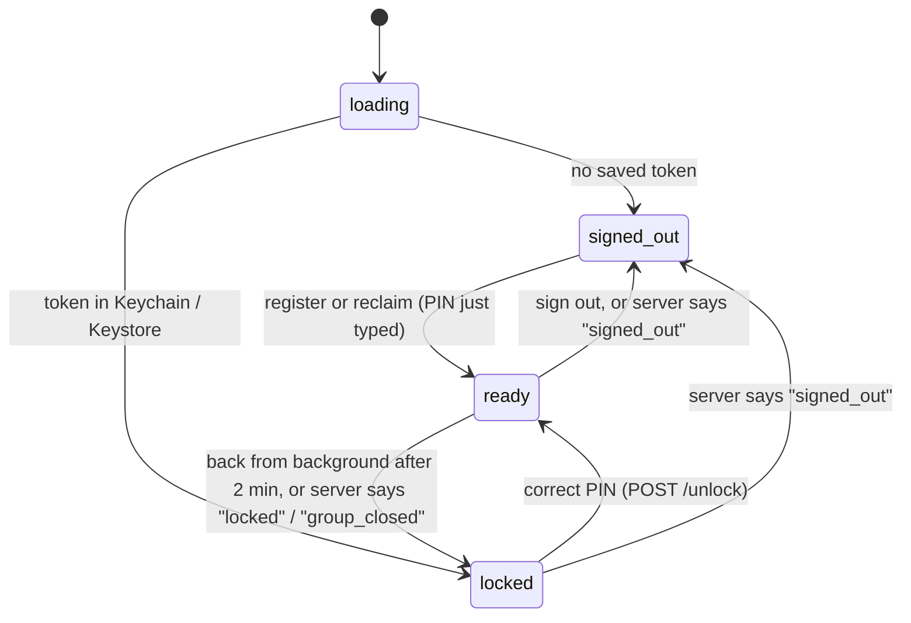
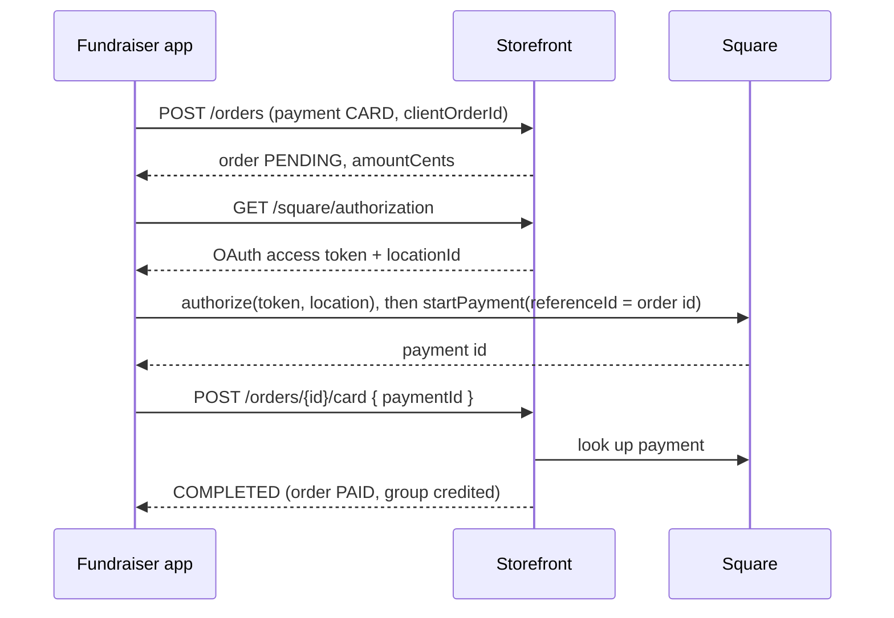

# Architecture

The app is small on purpose: about 1,600 lines of TypeScript across nine screens, one shared UI
file and six library modules. Business rules (prices, who may sell, whether a payment counts)
live on the server, so the app mostly collects input, calls the API and shows the answer.

## Folder layout

<Files>
  <Folder name="apps/fundraiser-app" defaultOpen>
    <File name="app.json" />
    <File name="eas.json" />
    <File name="package.json" />
    <File name="tsconfig.json" />
    <File name="AGENTS.md" />
    <Folder name="assets">
      <File name="icon.png" />
    </Folder>
    <Folder name="plugins" defaultOpen>
      <File name="with-square-mobile-payments.js" />
    </Folder>
    <Folder name="src" defaultOpen>
      <Folder name="app" defaultOpen>
        <File name="_layout.tsx" />
        <File name="welcome.tsx" />
        <File name="join.tsx" />
        <File name="reclaim.tsx" />
        <File name="lock.tsx" />
        <File name="index.tsx" />
        <File name="sell.tsx" />
        <File name="new-order.tsx" />
        <File name="orders.tsx" />
        <File name="organizer.tsx" />
      </Folder>
      <Folder name="components">
        <File name="ui.tsx" />
      </Folder>
      <Folder name="lib" defaultOpen>
        <File name="api.ts" />
        <File name="config.ts" />
        <File name="session.tsx" />
        <File name="square.ts" />
        <File name="image-url.ts" />
        <File name="save-outcome.ts" />
      </Folder>
    </Folder>
  </Folder>
</Files>

| Path | What it holds |
|---|---|
| `app.json` | Expo config: name, bundle ids, icon and splash, plugins (including the Square plugin and Android SDK levels), `extra.apiUrl` |
| `eas.json` | EAS Build profiles (`preview` for internal distribution, `production` with remote auto-incrementing build numbers) |
| `plugins/with-square-mobile-payments.js` | Config plugin that does all native setup for Square at prebuild time. See [Square SDK](/docs/apps/fundraiser-app/square-sdk) |
| `src/app/` | Expo Router routes: every file is a screen, `_layout.tsx` is the navigator |
| `src/components/ui.tsx` | Shared building blocks: `Backdrop`, `Glass`, `Screen`, `Title`, `Card`, `Button`, `Field`, `PinField`, `ErrorText`, `Muted` |
| `src/lib/` | Everything that is not a screen: API client, session, Square wrapper, config and two pure helpers |

The `@/` alias points at `src/` (`tsconfig.json`), so imports read `@/lib/session`. Keep
non-route code out of `src/app/`, because Expo Router treats every file there as a screen.

## Screens and navigation

`src/app/_layout.tsx` wraps the app in `SafeAreaProvider` and `SessionProvider`, then renders
one native `Stack` whose screens are split into three groups with `Stack.Protected`. Only the
group matching the session status can be reached, so a locked phone cannot navigate back into
an order screen.

| Status | Screens | Purpose |
|---|---|---|
| `signed-out` | `welcome`, `join`, `reclaim` | First-time setup (group ID, group PIN, name, new PIN) or getting back in on a new phone |
| `locked` | `lock` | The personal PIN pad, shown on every launch |
| `ready` | `index` (home), `sell`, `new-order`, `orders`, `organizer` | Taking orders, the seller's own orders, and organizer tools |

| Screen | File | Calls |
|---|---|---|
| Welcome | `welcome.tsx` | none; links to Join or Get back in |
| Join your group | `join.tsx` | `POST /group`, then `POST /register` |
| Get back in | `reclaim.tsx` | `POST /roster`, then `POST /reclaim` |
| Lock | `lock.tsx` | `POST /unlock` (through the session) |
| Home | `index.tsx` | `GET /me`; opens Square's reader settings when cards are on |
| Sell (register) | `sell.tsx` | `GET /catalog`, `POST /orders`, card calls |
| Phone order | `new-order.tsx` | `GET /catalog`, `POST /orders`, card calls |
| My orders | `orders.tsx` | `GET /orders`; finishes or cancels an unfinished card sale |
| Organizer | `organizer.tsx` | `GET /organizer/sellers`, PIN reset, group PIN change |

## Session states

`src/lib/session.tsx` owns sign-in state and exposes it through `useSession()`.

- **The device token** comes back from `/register` or `/reclaim` and is stored with
  `expo-secure-store` under `jms.fundraiser.deviceToken` (iOS Keychain, Android Keystore). The
  server keeps only its SHA-256. Android backup is turned off (`allowBackup: false` and
  `configureAndroidBackup: false`), so a token never follows a seller to a restored phone.
- **The PIN is never stored on the phone.** Every cold start goes to `locked`, and the server
  checks the PIN. Order routes also refuse a session whose PIN was not entered in the last 12
  hours.
- **Relock.** `RELOCK_AFTER_MS` in `src/lib/config.ts` (2 minutes) is how long the app may sit in
  the background, for example while the seller phones a customer, before it asks for the PIN again.
- **Server-driven moves.** Every call goes through the session's `call()`, which passes failures
  to `handleError()`. An `ApiError` with code `signed_out` clears the token and signs Square out,
  `locked` returns to the PIN pad, and `group_closed` (the admin turned the app off or the
  campaign ended) signs Square out and returns to the PIN pad, which shows why.

## Talking to the server

`src/lib/api.ts` is the only place that calls `fetch`.

- Every request goes to `${API_URL}/api/fundraiser-app${path}` as JSON, with
  `Authorization: Bearer <device token>` when there is one. `API_URL` is resolved in
  `src/lib/config.ts`; see [Configuration](/docs/apps/fundraiser-app/configuration).
- A network failure becomes `ApiError('No connection…', 0)`. A non-2xx answer becomes an
  `ApiError` carrying the server's `error` message, the HTTP status and the optional `code`.
- The response types (`Group`, `Me`, `SignIn`, `RosterEntry`, `Product`, `OrderSummary`,
  `GroupSeller`) mirror what the storefront sends. When a route's response changes in
  `apps/storefront/lib/fundraiser-app`, update these interfaces in the same pull request.

The full route list, with which routes need a device token and which also need a recent unlock,
is in the monorepo's fundraiser mobile app feature page.

### Never saving an order twice

Both order screens make a `clientOrderId` (a UUID from `expo-crypto`) once per order and reuse
it on retries. The server answers a repeated id with the order it already has, and derives the
`APP-…` order number from it.

When a save fails, `mayHaveSaved()` in `src/lib/save-outcome.ts` decides whether it might still
have been recorded: no answer at all (status 0) or a 5xx might have saved, a 4xx did not. If it
might have, the register locks the cart and only lets the seller resend that exact sale under
the same id.

## A card sale, end to end

`src/lib/square.ts` wraps the Square SDK. The SDK is `require`d lazily, because importing it
where the native module is missing throws; `cardPaymentsAvailable` is false on the web and in
any build without the native module, and the Card option is hidden then.

1. **Record first.** The order is saved as `PENDING` with provider `SQUARE` before any card is
   touched.
2. **Sign the SDK in.** `authorize()` asks the storefront for a token every time, so a group
   whose card payments were switched off is stopped here even on a phone that was signed in. It
   re-authorizes only when the SDK is signed in to a different location. The register calls
   `warmUpCardReader()` when it opens, so Charge goes straight to the tap screen.
3. **Tap to Pay on iPhone** needs the shop's Apple account linked once per phone;
   `prepareTapToPay()` does that through `TapToPaySettings`. If it fails, keyed entry and a
   Square Reader still work.
4. **Take the card.** `startPayment()` runs with `ProcessingMode.ONLINE_ONLY` (the storefront
   must see the payment in Square), `autocomplete: true`, no surcharge, the order id as
   `referenceId`, and Tap to Pay plus keyed entry as extra methods.
5. **Confirm.** The app posts the Square payment id to `/orders/{id}/card` up to three times
   with a growing pause. The storefront marks the order paid only if Square shows a completed
   payment at our location for exactly the order total that no other order has used.
6. **Retry safely.** "Try card again" first calls `GET /orders/{id}/card`, which finds any
   earlier payment by its reference. It charges again only when Square has none, so a customer is
   never charged twice. If that check itself fails, the app stops rather than risk a second charge.
7. **Give up.** `cancelCardOrder()` posts to `/orders/{id}/card/cancel`; the storefront cancels
   unless Square shows the order was paid after all.

Signing out calls `deauthorizeSquare()`, so no Square token is left on the phone.

## Look and feel

`src/lib/config.ts` holds the palette (`colors`), a light Apple-style "Liquid Glass" look:
dark text on frosted panels over a soft gradient backdrop. `Glass` in `src/components/ui.tsx`
uses `expo-glass-effect`'s `GlassView` where iOS supports Liquid Glass and falls back to an
`expo-blur` `BlurView` elsewhere. On iOS the stack header is transparent, which iOS 26 renders as
glass. The app is portrait only and forces light mode (`userInterfaceStyle: "light"`).

## Tests

The app has no test runner of its own: adding one breaks the `npm ci` that EAS builds run.
Instead, helpers that import nothing (`image-url.ts`, `save-outcome.ts`) are tested from the
storefront suite in `apps/storefront/tests/lib/fundraiser-app/app-client.test.ts`. The server
side of every route has its own tests in the same folder. Keep new pure logic in import-free
files under `src/lib/` so it can be covered the same way.
