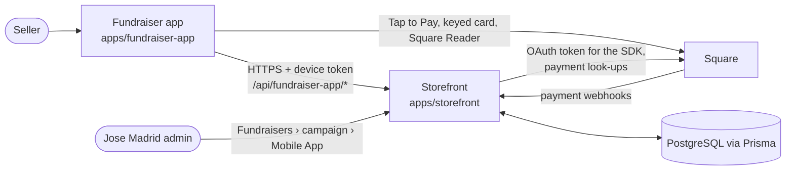

# Fundraiser Mobile App

The fundraiser app is the phone app students and other sellers use to take salsa orders for
their group: face to face at a register, or over the phone for delivery later. It is one app in
the App Store and Google Play for every group; it becomes a group's app once a seller enters that
group's ID, and everything group-specific (name, salsas, prices, whether cards are allowed) comes
from the server.

This section is for developers. It covers how the app is built, how to run it on a simulator or
a phone, how the Square payments SDK is wired in, and how it is configured. For what staff and
sellers do with the app (turning it on for a group, PINs, the organizer seat), see the monorepo's
`apps/docs/content/docs/features/fundraiser-mobile-app.mdx`.

<Callout type="info" title="Checked against the code">
Written from `jordolang/josemadridsalsa` at commit `ffc9ecf` (14 October 2026). The app lives in
`apps/fundraiser-app`; its server half lives in the storefront.
</Callout>

## At a glance

| | |
|---|---|
| Code | `apps/fundraiser-app` (not an npm workspace; it has its own `package-lock.json`) |
| Stack | Expo SDK 57, React Native 0.86, React 19.2, Expo Router 58 (typed routes), TypeScript 6 |
| Payments | Square Mobile Payments SDK (`mobile-payments-sdk-react-native` 2026.8.1), wired in by a local config plugin |
| Native projects | Generated by `expo prebuild` (Continuous Native Generation). `ios/` and `android/` are gitignored and never edited by hand |
| Server | `/api/fundraiser-app/*` on the storefront (`https://www.josemadridsalsa.com` by default) |
| Bundle id / package | `net.josemadrid.fundraiser` on both platforms; URL scheme `jmsfundraiser` |
| Builds | Local: `npx expo run:ios` / `npx expo run:android`. Store: EAS Build and EAS Submit |
| Tests | None in the app. Its pure helpers are tested from the storefront's Vitest suite |

<Callout type="warn" title="Expo Go is not supported">
The app depends on Square's native SDK, which Expo Go does not contain. Always run a native build
(`npx expo run:ios`, `npx expo run:android`, or `npx expo prebuild` and Xcode). The `ios` and
`android` npm scripts already do this.
</Callout>

## How it fits in

- The app talks to **one server**: the storefront's `/api/fundraiser-app/*` routes
  (`apps/storefront/app/api/fundraiser-app`, with the logic in `apps/storefront/lib/fundraiser-app`
  and `packages/core/lib/fundraiser-app`).
- It never prices anything. It sends product ids and quantities; the server prices the order
  from the group's fundraiser store.
- Card money goes to Jose Madrid's Square account. The phone gets a short-lived Square OAuth
  token from the storefront after the seller unlocks; no Square secret is built into the app.
- An order is only marked paid once the storefront has looked the payment up **in Square** and
  checked its location, amount and reference.

## In this section

<Cards>
  <Card title="Architecture" href="/docs/apps/fundraiser-app/architecture" description="Folders, screens, session states, the API client and how a card sale flows" />
  <Card title="Local setup" href="/docs/apps/fundraiser-app/local-setup" description="Prerequisites, installing, and pointing a build at a local storefront" />
  <Card title="Configuration" href="/docs/apps/fundraiser-app/configuration" description="Every setting the app, its build and its server read, and where to set each" />
  <Card title="Square SDK" href="/docs/apps/fundraiser-app/square-sdk" description="The native payments SDK, the config plugin, sandbox builds and Tap to Pay" />
  <Card title="Running on iOS" href="/docs/apps/fundraiser-app/ios" description="expo run:ios, prebuild with Xcode, signing, and iOS troubleshooting" />
  <Card title="Running on Android" href="/docs/apps/fundraiser-app/android" description="expo run:android, Android Studio, and Android troubleshooting" />
</Cards>
